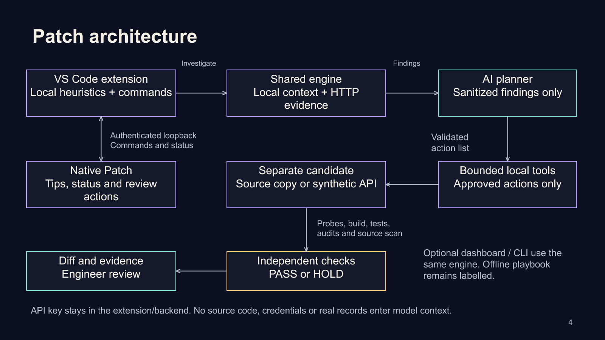
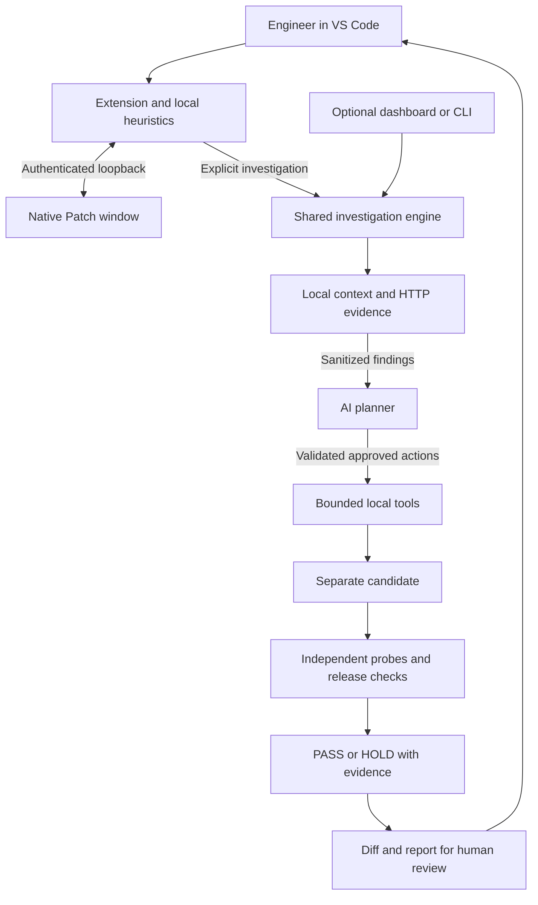

# Patch architecture

The native dog and VS Code extension run locally. The extension scans the active file with bounded heuristics and sends only compact findings and progress to the pet through an authenticated loopback bridge.

An explicit investigation invokes the shared engine. Local tools gather HTTP evidence. The AI receives sanitized findings and chooses approved actions. Tools apply those actions to a separate candidate; independent probes and, for the project-copy recipe, builds, API tests, dependency audits and a source scan determine the gate. Patch opens a diff and report for the engineer. There is no automatic deployment.

## Interfaces and boundaries

| Component | Implementation and responsibility |
| --- | --- |
| VS Code extension | CommonJS extension, active-file heuristics, commands, key lookup and diagnostics |
| Floating Patch | Python/tkinter transparent window, sprite states, tips and review actions |
| Loopback bridge | Ephemeral 127.0.0.1 port, random session token, Host validation, Origin rejection and an action allowlist |
| Investigation engine | Node.js orchestrator, persisted evidence, bounded actions, cancellation and candidate integrity checks |
| AI adapter | One capped request; structured action validation; no source code, secrets or real records in model context |
| Local candidates | Synthetic facility policy API, or an isolated compatible iVoucher copy with synthetic database responses |
| Verifier and gate | Fixed HTTP expectations; project build/tests/audits; failures and unresolved advisories keep HOLD |
| Human review | VS Code diff and Markdown report; engineer decides the next step |

The optional dashboard and CLI invoke the same engine. API keys stay in the extension/backend and never go to the native pet. Technical evidence retains the actual model and transport. The offline playbook remains visibly distinct from AI mode.

## Editable flow

The diagram is also editable in slide 4 of [the PowerPoint deck](Patch-Submission.pptx). Implementation: [extension](../companion/extension.cjs), [bridge](../companion/lib/bridge.cjs), [controller](../companion/lib/investigation.cjs), [engine](../src/agent.mjs), [project recipe](../src/project-lab.mjs), [provider validation](../src/providers.mjs).
